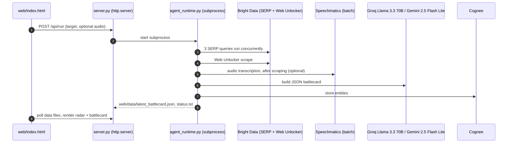

# OmniSight

> A competitor-research dashboard: enter a company name (and optionally an audio clip) and it combines Bright Data search results, a Speechmatics transcript and an LLM summary into one battlecard, to replace hours of manual competitor research.

**Status:** Hackathon prototype — lablab.ai "Web Data UNLOCKED" hackathon (2,310 participants) · 2nd place, Speechmatics track. A scan cannot complete on `main` as it stands (see [Limitations](#limitations--roadmap)).

---

## Architecture & Workflow

The server is a Python standard-library `http.server` (not FastAPI). Each scan starts `agent_runtime.py` as a subprocess; the page polls for its output.



## Key Features

- **Search signals:** pricing, hiring and sentiment queries through Bright Data's SERP API, plus one Web Unlocker scrape (`agent_runtime.py`).
- **Audio transcript:** Speechmatics batch transcription with speaker diarization, in live mode only. YouTube links are downloaded with `yt-dlp`.
- **LLM battlecard:** Groq (Llama 3.3 70B) first, Gemini 2.5 Flash Lite as fallback, both through the OpenAI SDK, returning JSON.
- **Graph memory:** entities are stored with Cognee (local).
- **Dashboard:** vanilla JS, Tailwind (CDN) and Chart.js; the radar axes are Pricing, Performance, Features, Mobile and Support.

## Quickstart & Installation

### Prerequisites
- Python 3.12 (the version pinned in `render.yaml`)
- API keys: Groq or Gemini; Bright Data; Speechmatics (audio only)

### Setup
```bash
git clone https://github.com/HamzaKhanBUIC/OmniSight-Autonomous-Corporate-Strategy-Disruption-Radar.git
cd OmniSight-Autonomous-Corporate-Strategy-Disruption-Radar
pip install -r requirements.txt
```
Create a `.env` in the repo root (see Configuration), then:
```bash
python server.py
```
Open http://localhost:8000.

Note: `pip install` was not completed in the audit environment (disk full while fetching a `cognee` dependency), and all requirements are unpinned.

## Configuration & Environment

| Variable | Default | Description |
| :--- | :--- | :--- |
| `GROK_API_KEY` | none | Groq API key. The name is spelled `GROK` in the code. |
| `GEMINI_API_KEY` | none | Gemini key; fallback LLM and Cognee embeddings |
| `BRIGHT_DATA_API_KEY` | none | Bright Data. If missing, the agent runs in simulation mode |
| `BRIGHT_DATA_SERP_ZONE` | `serp_api1` | Bright Data SERP zone |
| `BRIGHT_DATA_UNLOCKER_ZONE` | `web_unlocker1` | Bright Data Web Unlocker zone |
| `SPEECHMATICS_API_KEY` | none | Audio transcription; skipped if unset |
| `PORT` | `8000` | HTTP port |

## Testing & Verification

There are no automated tests on `main`. `scratch/test_cognee.py` and `scratch/test_gemini.py` are manual scripts that need real keys.

## Architectural Decisions & Trade-offs

- **Standard-library server plus subprocess:** no web framework to install; one scan at a time, with no job isolation (all scans share the same output files).
- **Groq first, Gemini fallback:** a second provider is used when the Groq call fails or is not configured.
- **Static frontend:** one HTML file, no build step.

## Limitations & Roadmap

- **Scans fail on `main`.** `system_instructions.txt` was deleted in commit `11c27af`, and the agent exits with "system_instructions.txt not found". The file is restored in [open PR #1](https://github.com/HamzaKhanBUIC/OmniSight-Autonomous-Corporate-Strategy-Disruption-Radar/pull/1); merge that first.
- **Simulation mode invents data.** With no Bright Data key, the agent tells the LLM to generate plausible indicators from its own knowledge instead of using web results (`agent_runtime.py`, "SIMULATION MODE ACTIVE").
- **Only the three SERP queries run concurrently.** Scraping runs first and audio transcription afterwards.
- **No authentication or rate limit** on `/api/run`, and one shared job slot. The server's web root also serves runtime files and directory listings.
- **Security fixes pending:** SSRF on the audio URL, upload path traversal, stored XSS, and disabled TLS verification are addressed in PR #1, not on `main`. Do not host this publicly until it is merged.
- **The tracked repo includes** downloaded YouTube audio under `web/temp_audio/` and a run log in `web/data/`.
- **Memory:** the author's submission notes say audio processing plus local embeddings needs about 1 GB of RAM and crashed on Render's 512 MB free tier ([`lablab_submission.md`](lablab_submission.md)).
- **Not verified:** a full live scan with real keys, and the Speechmatics and Cognee steps at runtime.

## License

MIT. See [LICENSE](LICENSE).
