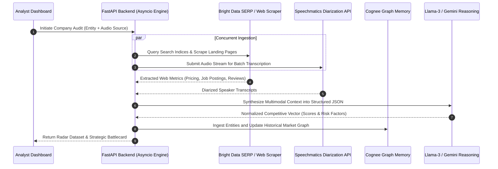

# OmniSight: Autonomous Corporate Strategy & Disruption Radar

> Multi-source competitive intelligence engine synthesizing live web telemetry, audio transcripts, and knowledge graphs into dynamic strategy dashboards.

[](https://python.org/)
[](https://fastapi.tiangolo.com/)
[](LICENSE)

---

## Overview

Market strategy and competitive analysis workflows often require manual synthesis across earnings call audio, pricing changes, hiring velocity, and web telemetry.

**OmniSight** automates this analysis through a concurrent agent pipeline:
1. **Live Web & Search Scraping**: Extracts recent pricing pivots, hiring trends, and customer sentiment signals via SERP APIs and headless web scrapers.
2. **Audio Intelligence**: Transcribes executive earnings calls or product presentations with speaker diarization.
3. **Graph Memory Synthesis**: Persists entity relations and historical market shifts into a local vector/knowledge graph via Cognee.
4. **Interactive Visualization**: Formats findings into dual-layered radar comparisons and structured intelligence battlecards.

---

## Architecture Flow



---

## Core Capabilities

- **Concurrent Agent Ingestion**: Parallel asynchronous coroutines execute web scraping and batch audio processing concurrently to reduce pipeline latency.
- **Multimodal Diarization**: Extracts strategic signals, executive quotes, and sentiment directly from multi-speaker audio recordings.
- **Persistent Market Graphs**: Maintains cross-scan entity relationships in a local vector/knowledge graph.
- **Dynamic Radar Analytics**: Produces standardized competitive vectors across hiring velocity, product innovation, pricing pressure, and customer sentiment.

---

## Repository Structure

```
.
├── static/                   # Frontend assets, Tailwind CSS, Chart.js radar views
├── templates/                # HTML dashboard layouts
├── server.py                 # Core FastAPI server and asynchronous pipeline
├── requirements.txt          # Python dependencies
└── README.md
```

---

## Getting Started

### Prerequisites
- Python 3.10 or higher
- API credentials for Google Gemini (or Groq), Bright Data, and Speechmatics

### Local Setup

1. **Clone the repository**:
   ```bash
   git clone https://github.com/HamzaKhanBUIC/OmniSight-Autonomous-Corporate-Strategy-Disruption-Radar.git
   cd OmniSight-Autonomous-Corporate-Strategy-Disruption-Radar
   ```

2. **Install dependencies**:
   ```bash
   pip install -r requirements.txt
   ```

3. **Configure environment variables**:
   Create a `.env` file in the root directory:
   ```env
   BRIGHT_DATA_API_KEY=your_bright_data_key
   SPEECHMATICS_API_KEY=your_speechmatics_key
   GEMINI_API_KEY=your_gemini_key
   GROQ_API_KEY=your_groq_key
   ```

4. **Launch the backend server**:
   ```bash
   python server.py
   ```
   Open `http://localhost:8000` in your browser.

---

## Deployment Guidelines

When running on Linux-based container runtimes (such as Google Cloud Run or AWS ECS), ensure the container entrypoint invokes `python server.py` directly and allocate at least 1 GB of memory for local vector indexing during audio processing.

---

## License

This project is licensed under the MIT License. See [LICENSE](LICENSE) for details.
